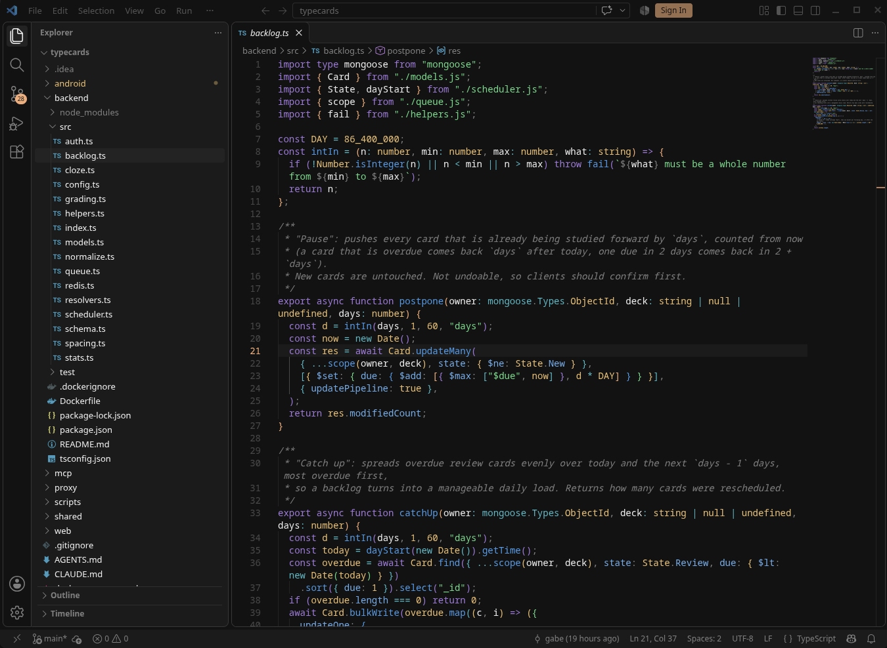

# OpenCode Peach

A dark VS Code theme built from **OpenCode's** default color palette: near-black
surfaces, a warm peach accent, and a calm, readable 16-color syntax and
terminal set. Same palette used across Ghostty, bash, and Android Studio for
a consistent setup end to end.



## Features

- Full workbench coverage: editor, sidebar, tabs, status bar, panels, and
  terminal all share the same near-black foundation (`#0a0a0a`).
- Peach accent (`#fab283`) for the cursor, focus rings, primary buttons, and
  heading links.
- Syntax colors tuned for readability: green strings, yellow types/numbers,
  blue functions/links, purple keywords, cyan operators/decorators, red
  errors.
- Matching 16-color ANSI terminal palette, so the integrated terminal looks
  the same as the rest of the editor.
- Markdown heading colors: h1 peach, h2 yellow, h3 green, h4 cyan, h5 purple,
  h6 muted.

## Install

Search **"OpenCode Peach"** in the Extensions view, or run:

```
ext install borealstars.opencode-theme
```

Then select it from `Preferences: Color Theme` (it's listed as **OpenCode**
in the picker).

## Palette reference

### Surfaces and text
| Role | Hex |
|---|---|
| Page background | `#0a0a0a` |
| Panel (sidebar, tabs, status bar) | `#141414` |
| Element / raised / inputs | `#1e1e1e` |
| Selected row | `#282828` |
| Selection | `#3c3c3c` |
| Border | `#484848` |
| Text | `#eeeeee` |
| Muted text | `#808080` |

### Accent and meaning
| Role | Hex |
|---|---|
| Accent (peach) | `#fab283` |
| Accent hover | `#e9cb92` |
| Success / green | `#7fd88f` |
| Error / red | `#e06c75` |
| Warning / yellow | `#e5c07b` |
| Blue | `#5c9cf5` |
| Blue (light) | `#79adf6` |
| Purple | `#9d7cd8` |
| Cyan | `#56b6c2` |

## License

MIT — see [LICENSE](LICENSE).
